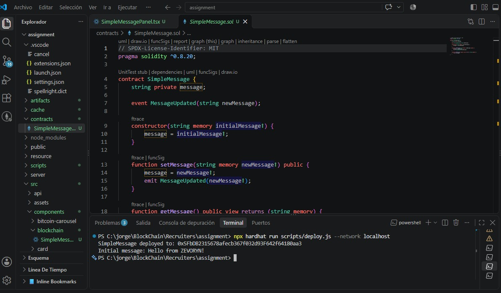
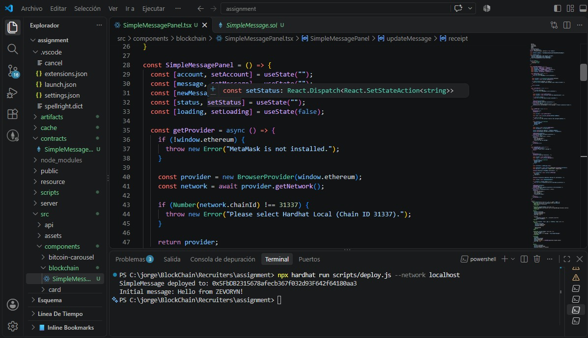

# Challenge 01 – React + MetaMask + Hardhat + Solidity

---

## 1. Project Overview

This project demonstrates the integration of a **React + TypeScript frontend** with a **Solidity smart contract**, using **MetaMask**, **Hardhat**, and **Ethers.js**.

The application allows users to connect their wallet, read a message stored on the blockchain, and update it through a confirmed blockchain transaction.

## 2. Implemented Features

- MetaMask wallet connection.
- Local Hardhat network integration.
- Smart contract interaction using Ethers.js.
- Reading on-chain messages.
- Updating contract state through transactions.
- Gas estimation before transaction submission.
- Transaction confirmation and status feedback.
- Basic error handling and network validation.

## 3. Smart Contract – SimpleMessage.sol

The Solidity contract implements:

- `getMessage()` – Reads the current stored message.
- `setMessage()` – Updates the stored message.
- `MessageUpdated` – Event emitted when the message changes.

Source: [`contracts/SimpleMessage.sol`](contracts/SimpleMessage.sol)

## 4. Frontend Integration – React + TypeScript

The `SimpleMessagePanel.tsx` component provides the user interface for connecting MetaMask and interacting with the deployed contract.

Source: [`src/components/blockchain/SimpleMessagePanel.tsx`](src/components/blockchain/SimpleMessagePanel.tsx)

## 5. Technologies Used

- React
- TypeScript
- Solidity 0.8.20
- Hardhat
- Ethers.js
- MetaMask
- Ethereum development environment

## 6. Main Screenshots

### Dashboard – Smart Contract Panel

### Smart Contract – Read Message

### Solidity Smart Contract

### React + TypeScript Integration

### MetaMask – Transaction Confirmation

### Message Updated Successfully

## 7. Video Demonstration

🎥 **Full project demonstration:**

[Watch the Loom Demo](https://www.loom.com/share/31d5e4c6877a495094e8fb2e2e59aebe)

## 8. Network Configuration

The demonstration was performed using a local Hardhat development network.

- Network: Hardhat Local
- RPC: `http://127.0.0.1:8545`
- Chain ID: `31337`
- Environment: Local development
- Currency: Test ETH

**Note:** The displayed ETH balance belongs to a local development account. It is not real ETH and has no monetary value.

Configuration: [`hardhat.config.js`](hardhat.config.js)

## 9. Technical Evidence

This repository includes:

- Solidity smart contract implementation.
- React + TypeScript blockchain integration.
- Hardhat network configuration.
- Six screenshots documenting the implementation and execution.
- Video demonstration.

---

## Prepared by

**Jorge Paez — Blockchain & Web3 Developer**